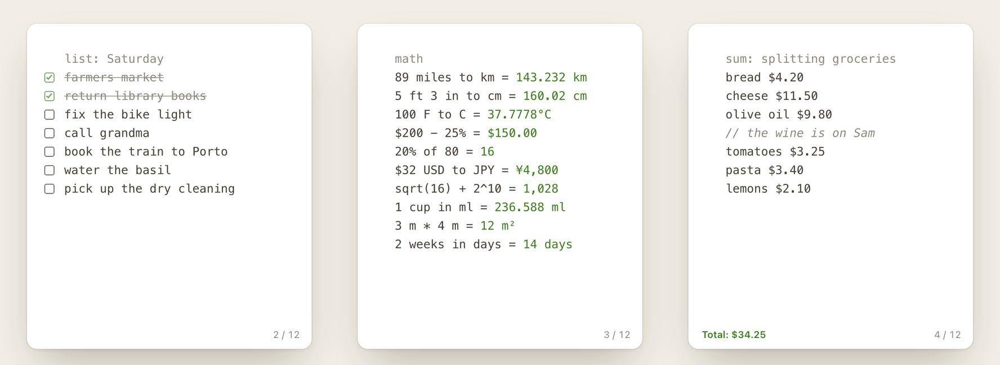

<p align="center">
  
</p>

<h1 align="center">Jotter</h1>

<p align="center">
  <b>A scratchpad for your Mac. Jot first, sort never.</b><br>
  Press <kbd>⌥A</kbd>, type, and the first word turns the note into a checklist, a calculator or a timer.<br>
  Free, open source and local: your notes never leave your Mac unless you turn on a feature that needs the network.
</p>

<p align="center">
  <a href="https://udsy19.github.io/Antinote/"><b>Website</b></a> ·
  <a href="https://github.com/udsy19/Antinote/releases/latest/download/Jotter.dmg"><b>Download</b></a> ·
  <a href="CHANGELOG.md">Changelog</a> ·
  <a href="PRIVACY.md">Privacy</a>
</p>

<p align="center">
  <a href="https://github.com/udsy19/Antinote/releases/latest"></a>
  
  
  <a href="https://github.com/udsy19/Antinote/actions/workflows/ci.yml"></a>
  <a href="LICENSE"></a>
</p>

<p align="center">
  
</p>

---

## Install

**One line.** Downloads the latest release, installs it into Applications and opens it:

```bash
curl -fsSL https://udsy19.github.io/Antinote/install.sh | bash
```

**Or download the [DMG](https://github.com/udsy19/Antinote/releases/latest/download/Jotter.dmg)**, drag Jotter to
Applications and open it. Jotter isn't notarized by Apple, so the first launch of a browser-downloaded copy needs
**System Settings → Privacy & Security → Open Anyway** (only once). The one-line installer doesn't need this step.

Requires macOS 14 Sonoma or later, Apple silicon or Intel. Run the same command to update; add
`-s -- --uninstall` after `bash` to remove it.

## Quick start

1. Open Jotter. A short deck of tutorial notes walks you through the basics.
2. Press <kbd>⌥A</kbd> from anywhere to show or hide the scratchpad, and start typing.
3. Swipe with two fingers (or press <kbd>⌘[</kbd> / <kbd>⌘]</kbd>) to move through your notes. Swipe past the newest
   one to start a fresh note; empty notes clean themselves up.
4. Put a keyword like `list`, `math` or `timer` on the first line to change what the note does.

## Why Jotter?

- **Instant.** One hotkey, one small window, no titles, no folders. Write it down before you forget it.
- **The first word does the work.** Checklists, math with units and currencies, running totals, timers and code,
  all from plain text you can copy anywhere.
- **Local by default.** No account, no analytics, no servers. Every network feature has its own off switch.
- **Hackable.** `::` commands are small JavaScript extensions you can read, change or write yourself.
- **Native and light.** Swift and AppKit, no Electron, no third-party dependencies.

## The first word decides

Every note starts as plain text. Put a keyword on the first line and the note changes what it does. Delete the word
and it's plain text again. Add your own keywords in **Settings → Keywords**.

### `list` · `todo` · `checklist` · `tasks`

Every line becomes a checkbox. Click to tick it, or press <kbd>⇧⌘M</kbd>. Return continues the list.

```text
list: Saturday
[x] farmers market
[ ] fix the bike light
[ ] call grandma
```

Checkboxes, bullets (`- `) and numbers (`1. `) also work inline in any note. <kbd>⌃⇧⌘M</kbd> cycles between them.

### `math` · `calc`

Lines ending in `=` get answered, right after the `=`. Descriptive words are ignored, variables are defined with a
colon, and `ans` is the previous answer.

```text
math: Lisbon weekend
nights: 3
hotel: €96 × nights = €288.00
food: €40 × nights = €120.00
total = €408.00
each: ans / 3 = €136.00

89 miles to km = 143.232 km
100 F to C = 37.7778°C
$200 - 25% = $150.00
$32 USD to JPY = ¥4,800
```

Units (length, mass, volume, area, temperature, time, data, speed, angle), currencies by code, name or symbol, the
common cryptocurrencies, percentages, functions (`sqrt`, `round`, `log`, `sin`…) and running totals with `total` or
`average`. Results are calculated, not typed, so they never end up in what you copy. Click one to copy it.

### `sum` · `avg` · `count`

Adds up, averages or tallies everything below the first line, even numbers inside sentences. Lines starting with
`//` are skipped.

```text
sum: splitting groceries
bread $4.20
cheese $11.50
// the wine is on Sam
tomatoes $3.25
```

The note shows **Total: $18.95** at the bottom. `avg` averages instead, and `count` reports items, lines, words
and characters.

### `timer` · `stopwatch` · `countdown` · `pomodoro`

```text
timer              a stopwatch
timer 5            a five-minute countdown
timer 5:30 : tea   a named countdown
timer pomo         25 minutes of work, 5 of rest, repeated
timer 52 17        your own pomodoro
timer breathe      breathe in for 4 seconds, out for 6
```

`timer p`, `timer r` and `timer s` pause, reset and stop it. Running timers show in the
menu bar and survive a restart.

### `code` · `snippet`

Syntax highlighting for Swift, Python, JavaScript/TypeScript, Go, Rust, C-family languages, shell, SQL, Ruby and
JSON (auto-detected, or `code python`). Pasted text stays exactly as you copied it. Fenced ` ``` ` blocks work in
any note.

### `paste` · `autopaste`

Press Return on the first line and everything you copy is added to the note, cleaned up, one item per line. Esc
stops.

## `::` extensions

Type `::` anywhere for autocomplete, then press Return to run the command on that line.

```text
::today                       October 17, 2026
::today(7, eu)                24/10/2026
::workday(3)                  October 21, 2026
::tip(120, 20, 4)             Tip: 24.00 · Total: 144.00 · Each: 36.00
::pick(pizza, sushi, tacos)   sushi
```

| Extension | Commands |
|---|---|
| date | `::today`, `::tomorrow`, `::yesterday`, `::workday` |
| lines | `::sort`, `::sort_desc`, `::reverse`, `::shuffle`, `::dedupe`, `::remove_empty`, `::number_lines`, `::trim` |
| text | `::upper`, `::lower`, `::title`, `::sentence`, `::slug`, `::snake`, `::camel`, `::count_chars` |
| random | `::dice`, `::coin`, `::uuid`, `::password`, `::pick` |
| json | `::format`, `::minify`, `::validate` |
| regex | `::replace_regex(pattern, replacement, flags)` |
| finance | `::loan`, `::tip`, `::percent_change`, `::compound` |
| checklists | `::check_all`, `::uncheck_all`, `::remove_checked`, `::checked_to_bottom` |
| templates | `::meeting`, `::standup`, `::journal` |
| llm | `::ask`, `::summarize`, `::rewrite`, `::translate` with your own OpenAI, Anthropic, Gemini or OpenRouter key, or a local Ollama model |

Extensions are folders with an `extension.json` and an `index.js`, run in their own JavaScriptCore context. Install
more from GitHub in **Settings → Extensions**, or drop a folder into `~/Library/Application Support/Jotter/Extensions`.
An extension can only reach the network when **Extension APIs** is on, only at the URLs it declares, and only with
API keys you granted it.

<details>
<summary><b>Everything else</b></summary>

- **The deck.** Notes pile up newest first. Swipe or press <kbd>⌘[</kbd> / <kbd>⌘]</kbd>; <kbd>⇧⌘L</kbd> jumps to
  the newest. Optionally start a fresh note after a while away.
- **Nine slots.** Keep notes on <kbd>⌘1</kbd>…<kbd>⌘9</kbd> (<kbd>⌃⌘1</kbd>…<kbd>⌃⌘9</kbd> to assign) and open
  one next to the deck in split view (<kbd>⌃⌘S</kbd>).
- **The Void.** Deleted notes stay recoverable for 1, 7, 30 or 90 days, or forever. Daily automatic backups, with
  restore.
- **Locked notes.** Lock a note behind Touch ID or your password; it relocks after a few minutes away.
  Read-only and archived notes too.
- **Command palette and search.** <kbd>⌘K</kbd> runs any command, inserts keywords and extensions;
  <kbd>⇧⌘F</kbd> searches every note, archived ones included.
- **Export.** Apple Notes, Obsidian, Bear, Markdown, plain text, PDF and print. Quick Export with
  <kbd>⇧⌘E</kbd>, or export every note as Markdown plus a re-importable JSON file.
- **Encrypted sync.** Optional sync through your own iCloud Drive; notes are sealed with AES-GCM on your Mac
  first.
- **Writing.** Vim mode, find & replace, move and duplicate lines, strikethrough, link shortening, paste cleanup
  (markdown, bullets, numbering, empty lines), and text recognition from dropped images.
- **Look.** Built-in light and dark themes or your own theme files, lined, dotted or grid paper, font and text
  size, translucency on macOS 15+, alternative app icons.
- **Where it lives.** Dock, menu bar, both, a drop-down under the menu bar, or only the hotkey. Pin on top, hide
  when it loses focus, launch at login.

</details>

## Keyboard shortcuts

The global hotkey is <kbd>⌥A</kbd> by default (change it in **Settings → General**). Every menu shortcut is also
listed in **Settings → Shortcuts**.

| Shortcut | Action |
|---|---|
| <kbd>⌥A</kbd> | Show or hide Jotter (global) |
| <kbd>⌘N</kbd> | New note |
| <kbd>⌘[</kbd> / <kbd>⌘]</kbd> | Previous / next note |
| <kbd>⇧⌘L</kbd> | Newest note |
| <kbd>⌘1</kbd>…<kbd>⌘9</kbd> · <kbd>⌘0</kbd> | Open a slotted note · back to the deck |
| <kbd>⌃⌘1</kbd>…<kbd>⌃⌘9</kbd> | Put the current note in a slot |
| <kbd>⌘K</kbd> | Command palette |
| <kbd>⇧⌘F</kbd> | Search all notes |
| <kbd>⌘F</kbd> · <kbd>⌥⌘F</kbd> | Find · find & replace (<kbd>⌘G</kbd> / <kbd>⇧⌘G</kbd> next / previous) |
| <kbd>⌃Space</kbd> | Extension autocomplete |
| <kbd>⇧⌘M</kbd> | Toggle checklist item |
| <kbd>⌃⇧⌘M</kbd> | Cycle list style |
| <kbd>⌥⌘]</kbd> / <kbd>⌥⌘[</kbd> | Indent / outdent |
| <kbd>⌥⌘↑</kbd> / <kbd>⌥⌘↓</kbd> | Move line up / down |
| <kbd>⌥⇧⌘↑</kbd> / <kbd>⌥⇧⌘↓</kbd> | Duplicate line up / down |
| <kbd>⇧⌘X</kbd> | Strikethrough |
| <kbd>⌥⌘C</kbd> | Copy the whole note |
| <kbd>⌘L</kbd> | Select line |
| <kbd>⌥⌘L</kbd> | Expand all links |
| <kbd>⌘⌫</kbd> · <kbd>⇧⌘⌫</kbd> | Move to The Void · recover from The Void |
| <kbd>⇧⌘T</kbd> | Promote to front |
| <kbd>⌃⌘L</kbd> | Lock / unlock note |
| <kbd>⇧⌘R</kbd> | Read-only |
| <kbd>⇧⌘A</kbd> | Archive |
| <kbd>⇧⌘E</kbd> | Quick Export |
| <kbd>⌘P</kbd> | Print |
| <kbd>⇧⌘P</kbd> | Pin on top |
| <kbd>⌃⌘S</kbd> | Split view |
| <kbd>⌘=</kbd> · <kbd>⌘-</kbd> · <kbd>⌥⌘0</kbd> | Bigger · smaller · default text size |
| <kbd>⌘,</kbd> | Settings |

<details>
<summary><b>URL scheme</b></summary>

Automate Jotter from Shortcuts, Raycast, Alfred or Terminal (`open "jotter://…"`). Parameters are URL-encoded.

| URL | Action |
|---|---|
| `jotter://new?text=…` | Create a note at the front and show it |
| `jotter://append?text=…` | Append a line to the current note |
| `jotter://overwrite?text=…` | Replace the current note's text |
| `jotter://show?id=<uuid>` | Show a note |
| `jotter://promote?id=<uuid>` | Move a note to the front and show it |
| `jotter://togglepin` | Toggle pin on top |
| `jotter://palette`, `jotter://search?q=…`, `jotter://void` | Open the command palette, search or The Void |

Example: `open "jotter://append?text=buy%20milk"`

</details>

## Privacy

Jotter is a local app. Your notes live in a SQLite database in `~/Library/Application Support/Jotter`, and they
never leave your Mac unless you turn on a feature that needs the network. Each of those has its own switch in
**Settings → Privacy**, and **Turn Everything Off** makes Jotter fully offline:

| Switch | Default | What it does |
|---|---|---|
| Currency rates | On | Downloads daily exchange rates for currency math. Sends nothing of yours. |
| Extension updates | Off | Checks GitHub for updates to extensions you installed from there |
| Extension APIs | Off | Lets extensions call the endpoints they declare, with keys you grant |
| Sync notes / preferences | Off | Writes end-to-end encrypted copies to your own iCloud Drive |

No accounts, no analytics, no telemetry. Details in [PRIVACY.md](PRIVACY.md).

## Build from source

Only the Command Line Tools are needed (`xcode-select --install`). No Xcode project, no dependencies.

```bash
git clone https://github.com/udsy19/Antinote.git && cd Antinote
./scripts/signing-setup.sh        # once: local signing identity so Keychain access survives rebuilds
./scripts/build-app.sh            # → build/Jotter.app   (--debug for a faster build)
open build/Jotter.app
swift run JotterSelfTest          # logic tests
./scripts/make-dmg.sh             # universal DMG in dist/
```

See [ARCHITECTURE.md](docs/ARCHITECTURE.md) for how the modules fit together.

## Contributing

Issues and pull requests are welcome. Read [CONTRIBUTING.md](CONTRIBUTING.md) to get started, and please report
security issues privately as described in [SECURITY.md](SECURITY.md).

## License

[MIT](LICENSE) © Udaya Vijay Anand.

Jotter is an independent project inspired by [Antinote](https://antinote.io). It is not affiliated with or endorsed by
Antinote and contains none of its code.
